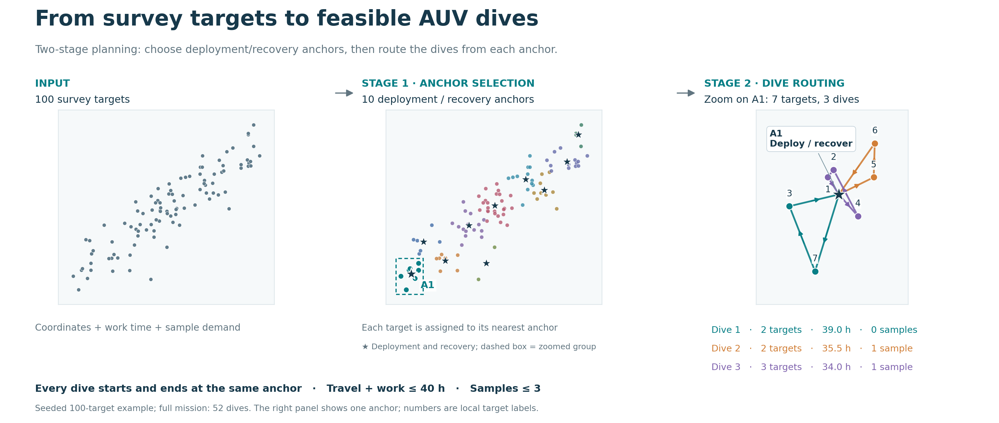

# Multipoint Seabed Survey Mission Planning

From survey targets to feasible AUV dive missions.

[](https://github.com/anyang1991/multipoint-seabed-survey/actions/workflows/tests.yml)
[](https://doi.org/10.5281/zenodo.23852697)
[中文说明](README.zh-CN.md) · [Paper](https://anyang.space/publication/2017-auv-path-planning/) · [Citation](CITATION.cff) · [Releases](https://github.com/anyang1991/multipoint-seabed-survey/releases)

Open-source Python software accompanying:

> Yang An, Gaofei Xu, Chunhui Xu, Hongyu Zhao, and Jian Liu.
> **Path Planning for Multipoint Seabed Survey Mission Using Autonomous Underwater Vehicle.**
> OCEANS 2017 - Anchorage, 2017, pp. 1–5.

The problem is to visit every survey target while keeping each dive within AUV endurance
and sample capacity and returning it to its support-vessel anchor. The planner uses two
stages: feasibility-aware K-means and greedy deletion choose deployment/recovery anchors;
ant-colony routing builds closed dives and minimizes distance and dive count. Automatic
CPU/GPU selection, parallel execution, and 300 dpi PNG plus editable SVG output support
reproducible experiments.



Read the saved example from left to right: targets, anchor selection, and dive routing.
Stars mark anchors. The detail enlarges A1, with one color per dive; A1 contains seven
targets and three dives. The complete 100-target reference uses 10 anchors and 52 dives.
See [detailed figures and export instructions](docs/figures.md).

## Quick start

Python 3.10 or later:

```bash
git clone https://github.com/anyang1991/multipoint-seabed-survey.git
cd multipoint-seabed-survey
python -m pip install -e .
python -m seabed_planner plan examples/paper-style-100.json --backend cpu --seed 2017 --output outputs/plan.json --plot outputs/plan.png
python -m seabed_planner validate outputs/plan.json
```

The plan record contains the complete mission, anchors, dive routes, search histories,
parameters, random seed, and execution information. The validation independently
recomputes coverage, closure, endurance, and sample capacity.

## Method and model

Stage 1 computes each target's feasible-anchor radius from paper Eq. (1), initializes
centers in occupied grid cells, refines assignments with K-means, and greedily removes
anchors while preserving coverage and round-trip feasibility. Stage 2 applies an
ant-cycle system independently within each anchor group. A candidate target enters a
route only when returning to the anchor remains feasible:

```text
travel_distance / speed + sum(workload_hours) <= endurance
sum(samples) <= capacity
```

Each anchor's objective is `distance × dives^κ`, with `κ=2` by default. Route-search
defaults are 500 iterations and 30 ants. The model assumes constant AUV speed, Cartesian
distances, fixed target work time, and nonnegative integer sample demand. Project
geographic coordinates before input. [Method and parameters](docs/method.md).

Inputs accept JSON, CSV, and MATLAB `.mat`. Target fields are `x`, `y`,
`workload_hours`, and `samples`; time is in hours, and speed and coordinates use matching
distance units. Saved route indices are zero-based. [Datasets and input format](examples/README.md).

## Relation to the original work

The Python implementation follows the paper's two-stage framework and vehicle model. It
records implementation choices in [method documentation](docs/method.md). The original
MATLAB source remains archived in [`legacy/`](legacy/README.md), outside the MIT grant,
with provenance and checksums recorded there. `paper-style-100.json` uses the paper's
simulation settings with a new seeded 100-target sample; `legacy-15.json` is converted
from the authors' `legacy/matlab/temp.mat` and preserves its original numeric units.

## Execution options

```bash
python -m seabed_planner hardware
python -m seabed_planner plan examples/paper-style-100.json --backend cpu --workers 4
python -m seabed_planner plan examples/paper-style-100.json --backend gpu
python -m seabed_planner generate --targets 100 --seed 2017 --output outputs/mission.json
```

Automatic mode selects a backend and worker count from workload size, available CPUs,
memory, CUDA arithmetic, and GPU memory. Install one CuPy distribution that matches the
CUDA environment:

| CUDA environment | Install command |
| --- | --- |
| CUDA 12 | `python -m pip install -e ".[gpu]"` |
| CUDA 13 | `python -m pip install -e ".[gpu13]"` |

See [execution and benchmark details](docs/performance.md).

## Reproduce the experiments

```bash
python -m pip install -e ".[test]"
python -m pytest -q
python -m experiments.verify_claims
python -m experiments.plot_evidence
```

The default protocol runs 12 independent 100-target missions with three search seeds
each. All 36 plans satisfy coverage, closure, endurance, and capacity constraints.
Compared with constrained nearest-neighbor routing at fixed anchors, the joint objective
is 18.90% lower on average (95% CI 14.05%–23.85%); all 36 paired runs are lower. For ten
8-target fixed-anchor instances, 22 of 30 searches reach the exact optimum, with mean
gap 0.43% and maximum gap 3.00%.

[Reproduction guide](docs/reproducibility.md) · [Results and protocol](docs/validation.zh-CN.md) ·
[Python API](docs/api.md) · [Figure export](docs/figures.md)

## Repository

| Path | Contents |
| --- | --- |
| `src/seabed_planner/` | Planner, CLI, hardware adaptation and plotting |
| `examples/` | Input datasets, saved plans and figures |
| `experiments/` | Framework validation, exact references and raw results |
| `benchmarks/` | CPU/GPU benchmarks and recorded measurements |
| `tests/` | Constraint, numerical and reproducibility checks |
| `legacy/` | Original MATLAB source and provenance |
| `docs/` | Method, reproduction and figure documentation |

## Citation and license

Software archive: [version 0.1.1](https://doi.org/10.5281/zenodo.23852698). Use
[10.5281/zenodo.23852697](https://doi.org/10.5281/zenodo.23852697) to cite the software
across versions, or the version DOI for the archived release used in an experiment.

Please cite the accompanying paper:

```bibtex
@inproceedings{an2017multipoint,
  title={Path planning for multipoint seabed survey mission using autonomous underwater vehicle},
  author={An, Yang and Xu, Gaofei and Xu, Chunhui and Zhao, Hongyu and Liu, Jian},
  booktitle={OCEANS 2017 - Anchorage},
  year={2017},
  pages={1--5},
  url={https://ieeexplore.ieee.org/document/8232284}
}
```

The MIT [license](LICENSE) applies to the Python implementation, tests, examples,
experiments, benchmarks, and documentation. [NOTICE](NOTICE) states the scope and paper
attribution. Contributions follow [CONTRIBUTING.md](CONTRIBUTING.md).
