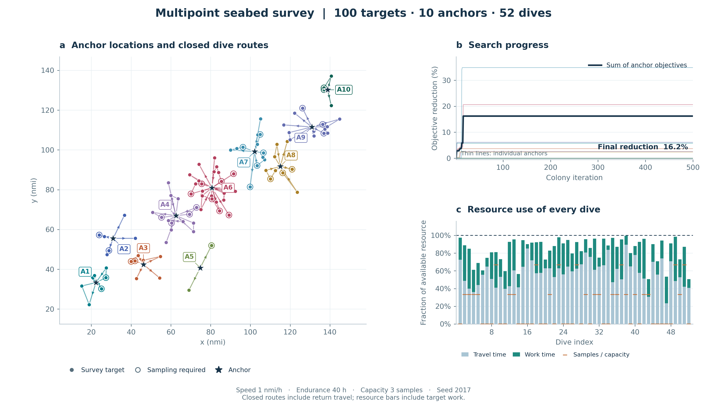

# Multipoint Seabed Survey Mission Planning

[](https://github.com/anyang1991/multipoint-seabed-survey/actions/workflows/tests.yml)
[中文说明](README.zh-CN.md) · [Paper](https://anyang.space/publication/2017-auv-path-planning/) · [Citation](CITATION.cff) · [Releases](https://github.com/anyang1991/multipoint-seabed-survey/releases)

Open-source Python software accompanying:

> Yang An, Gaofei Xu, Chunhui Xu, Hongyu Zhao, and Jian Liu.
> **Path Planning for Multipoint Seabed Survey Mission Using Autonomous Underwater Vehicle.**
> OCEANS 2017 - Anchorage, 2017, pp. 1–5.

The planner organizes multipoint AUV survey missions in two stages: iterative K-means and
greedy reduction select support-vessel anchors; ant-colony routing assigns closed dives
within endurance and sample-capacity constraints. It provides automatic CPU/GPU selection,
parallel execution, reproducible experiments, and publication-quality figures.



## Install and run

Python 3.10 or later:

```bash
git clone https://github.com/anyang1991/multipoint-seabed-survey.git
cd multipoint-seabed-survey
python -m pip install -e .
python -m seabed_planner plan examples/paper-style-100.json --output outputs/plan.json --plot outputs/plan.png
python -m seabed_planner validate outputs/plan.json
```

The output contains the complete mission, anchor locations, dive routes, search histories,
parameters, seed and execution information. Figures are exported as 300 dpi PNG and editable SVG.

## Execution options

```bash
python -m seabed_planner hardware
python -m seabed_planner plan examples/paper-style-100.json --backend cpu --workers 4
python -m seabed_planner plan examples/paper-style-100.json --backend gpu
python -m seabed_planner generate --targets 100 --seed 2017 --output outputs/mission.json
```

Automatic mode selects a backend and worker count from workload size, available CPUs,
memory and CUDA capability. Optional GPU installation:

| CUDA environment | Install command |
| --- | --- |
| CUDA 12 | `python -m pip install -e ".[gpu]"` |
| CUDA 13 | `python -m pip install -e ".[gpu13]"` |

Choose the extra matching your CUDA environment; install one CuPy distribution.
See [execution and benchmark details](docs/performance.md).

## Model and input

Each dive starts and ends at its anchor. Every target is visited once, with:

```text
travel_distance / speed + sum(workload_hours) <= endurance
sum(samples) <= capacity
```

The per-anchor objective is `distance × dives^κ`, with κ=2 by default. Route-search defaults
are 500 iterations and 30 ants. The model uses constant speed, planar distances and fixed
target workloads. See [method and parameters](docs/method.md).

Inputs accept JSON, CSV and MATLAB `.mat`. Target fields are `x`, `y`, `workload_hours`,
and nonnegative integer `samples`. Time is in hours; coordinates and speed use matching
distance units. Saved route indices are zero-based. See [datasets and input format](examples/README.md).

## Reproduce the experiments

```bash
python -m pip install -e ".[test]"
python -m pytest -q
python -m experiments.verify_claims
python -m experiments.plot_evidence
```

The validation covers 12 independent 100-target missions with three search seeds each.
All 36 plans satisfy the constraints. Compared with constrained nearest-neighbor routing,
the joint objective is 18.90% lower on average. For ten 8-target fixed-anchor instances,
22 of 30 runs reach the exact optimum, with a mean gap of 0.43%.

[Reproduction guide](docs/reproducibility.md) · [Results and protocol](docs/validation.zh-CN.md) ·
[Python API](docs/api.md) · [Figure export](docs/figures.md)

## Repository

| Path | Contents |
| --- | --- |
| `src/seabed_planner/` | Planner, CLI, hardware adaptation and plotting |
| `examples/` | Input datasets and saved planning results |
| `experiments/` | Framework validation, reference solutions and raw results |
| `benchmarks/` | CPU/GPU benchmarks and recorded measurements |
| `tests/` | Constraint, numerical and reproducibility checks |
| `legacy/` | Original MATLAB source and provenance |
| `docs/` | Method, reproduction and figure documentation |

## Citation and license

Please cite the accompanying paper:

```bibtex
@inproceedings{an2017multipoint,
  title={Path planning for multipoint seabed survey mission using autonomous underwater vehicle},
  author={An, Yang and Xu, Gaofei and Xu, Chunhui and Zhao, Hongyu and Liu, Jian},
  booktitle={OCEANS 2017 - Anchorage},
  year={2017},
  pages={1--5},
  url={https://ieeexplore.ieee.org/document/8232284}
}
```

The Python implementation, tests, examples and documentation use the [MIT license](LICENSE).
Original MATLAB files retain their existing notices; see [provenance](legacy/README.md).
For questions and contributions, see [CONTRIBUTING.md](CONTRIBUTING.md).
