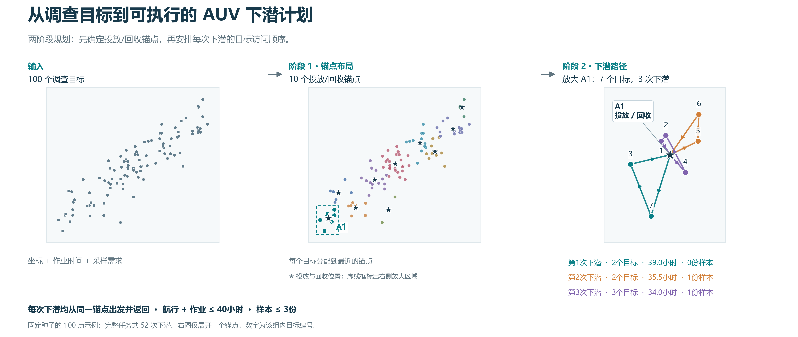

# 多点海底调查任务路径规划

从分散调查点，到满足约束的下潜任务。

[](https://github.com/anyang1991/multipoint-seabed-survey/actions/workflows/tests.yml)
[](https://doi.org/10.5281/zenodo.23852697)
[English](README.md) · [论文主页](https://anyang.space/publication/2017-auv-path-planning/) · [引用信息](CITATION.cff) · [版本下载](https://github.com/anyang1991/multipoint-seabed-survey/releases)

论文 **Path Planning for Multipoint Seabed Survey Mission Using Autonomous Underwater Vehicle**
的配套开源程序，作者为 Yang An、Gaofei Xu、Chunhui Xu、Hongyu Zhao、Jian Liu，发表于 OCEANS 2017 - Anchorage。

该问题要求访问每个调查目标，并让每次 AUV 下潜闭合于所属支撑船锚点，同时满足续航和采样容量约束。
规划分两阶段：可行域感知 K-means 与贪心删点确定投放回收锚点；蚁群算法规划闭合下潜路径并联合控制航程和下潜次数。
程序提供 CPU/GPU 自动适配、并行计算、可复现实验以及 300 dpi PNG 和可编辑 SVG 图件输出。



已保存算例从左向右展示调查目标、锚点选择和下潜路径。星号表示锚点；右侧放大 A1，
每个颜色对应一次下潜，其中包含 7 个目标和 3 次下潜。完整的 100 点参考算例使用 10 个锚点、52 次下潜。
[详细结果图与导出方法](docs/figures.md)。

## 快速开始

需要 Python 3.10 及以上：

```bash
git clone https://github.com/anyang1991/multipoint-seabed-survey.git
cd multipoint-seabed-survey
python -m pip install -e .
python -m seabed_planner plan examples/paper-style-100.json --backend cpu --seed 2017 --output outputs/plan.json --plot outputs/plan.png
python -m seabed_planner validate outputs/plan.json
```

计划记录包含完整任务输入、锚点、下潜路径、搜索历史、参数、随机种子和运行信息。
验证会独立重算目标覆盖、路径闭合、续航和采样容量。

## 方法与模型

第一阶段根据论文式 (1) 计算各目标对应的可行锚点半径，在占用网格中初始化中心，
用 K-means 细化分配，并在保持覆盖和单点往返可行的条件下贪心减少锚点。
第二阶段在各锚点分组内使用 ant-cycle 蚁群算法。候选目标加入路径后仍须能返回锚点：

```text
航程 / 航速 + 目标作业时间之和 <= 续航
样本数量之和 <= 采样容量
```

各锚点目标为 `航程 × 下潜次数^κ`，默认 `κ=2`；路径搜索默认 500 次迭代、每次 30 只蚂蚁。
模型采用恒定 AUV 航速、笛卡尔平面距离、固定目标作业时间和非负整数样本需求。
地理坐标应先投影为平面坐标。[方法与参数](docs/method.md)

输入支持 JSON、CSV 和 MATLAB `.mat`。目标字段为 `x,y,workload_hours,samples`；
时间单位为小时，坐标与航速使用配套的距离单位，保存的下潜目标编号从 0 开始。
[数据来源与输入格式](examples/README.md)

## 与原始工作的关系

Python 实现沿用论文的两阶段框架和载具模型，实现细节记录在[方法文档](docs/method.md)。
原始 MATLAB 源码归档于 [`legacy/`](legacy/README.md)，不包含在 MIT 授权范围内；
来源记录和校验和保存在同一目录。`paper-style-100.json` 采用论文仿真设置，并使用新的种子生成 100 点样本；
`legacy-15.json` 由作者提供的 `legacy/matlab/temp.mat` 转换而来，保留原始数值单位。

## 计算设置

```bash
python -m seabed_planner hardware
python -m seabed_planner plan examples/paper-style-100.json --backend cpu --workers 4
python -m seabed_planner plan examples/paper-style-100.json --backend gpu
python -m seabed_planner generate --targets 100 --seed 2017 --output outputs/mission.json
```

自动模式根据任务规模、可用 CPU、内存、CUDA 算术检查和 GPU 显存选择后端与进程数。
按 CUDA 环境选择安装一个 CuPy 发行版：

| CUDA 环境 | 安装命令 |
| --- | --- |
| CUDA 12 | `python -m pip install -e ".[gpu]"` |
| CUDA 13 | `python -m pip install -e ".[gpu13]"` |

[计算与性能说明](docs/performance.md)记录适配策略和实测结果。

## 实验复现

```bash
python -m pip install -e ".[test]"
python -m pytest -q
python -m experiments.verify_claims
python -m experiments.plot_evidence
```

默认协议包含 12 个独立的 100 点任务和每个任务 3 个搜索种子。36 次规划全部满足覆盖、
闭合路径、续航和采样约束。固定锚点后，与受约束最近邻策略相比，联合目标平均降低
**18.90%**（95% 区间 14.05%–23.85%），36 对结果全部更低。10 个 8 点固定锚点实例的
30 次搜索中，22 次达到精确最优，平均差距 **0.43%**，最大差距 3.00%。

[复现指南](docs/reproducibility.md) · [实验结果与方案](docs/validation.zh-CN.md) · [绘图说明](docs/figures.md)

## 项目结构

| 路径 | 内容 |
| --- | --- |
| `src/seabed_planner/` | 规划器、CLI、硬件适配和绘图 |
| `examples/` | 输入数据、保存的计划和图件 |
| `experiments/` | 框架验证、精确参考和原始结果 |
| `benchmarks/` | CPU/GPU 性能测试和记录结果 |
| `tests/` | 约束、数值和可复现性检查 |
| `legacy/` | 原始 MATLAB 源码和来源记录 |
| `docs/` | 方法、复现和绘图文档 |

## 引用与许可

软件已归档至 Zenodo：[0.1.1 版本](https://doi.org/10.5281/zenodo.23852698)。
引用软件项目使用[所有版本 DOI](https://doi.org/10.5281/zenodo.23852697)；
引用具体归档版本时，使用对应版本 DOI。

完整论文 BibTeX 见 [English README](README.md#citation-and-license)，
机器可读引用见 [CITATION.cff](CITATION.cff)。
Python 实现、测试、示例、实验、基准和文档采用 [MIT 许可证](LICENSE)；
[NOTICE](NOTICE) 说明适用范围和论文署名。问题反馈与贡献方式见 [CONTRIBUTING.md](CONTRIBUTING.md)。
