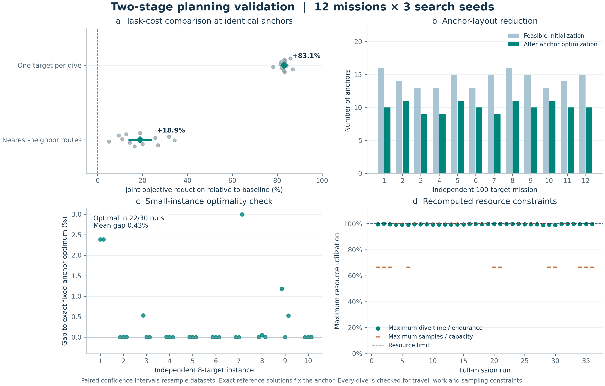

# 两阶段任务规划框架的实验验证

实验评价锚点选择、目标覆盖、受资源约束的路径规划和任务代价，采用与论文一致的恒速、平面距离、
固定作业时间及采样容量模型。

## 方案

12 个独立的 100 点任务分别使用生成种子 2017–2028；每个任务运行搜索种子 0、1、2，共 36 次规划。
参数为 500 次迭代、30 只蚂蚁、航速 1 节、续航 40 小时、容量 3，目标作业时间取 2、4、6、8 小时。

第一阶段记录可行初始化和优化后的锚点数量及覆盖；第二阶段与“逐目标单独下潜”和“受约束最近邻”策略比较。
路径比较固定锚点、目标分组和车辆参数。联合目标值定义为各锚点 `航程 × 下潜次数²` 的和。
百分比在同一任务中配对计算后求平均，95% 区间以独立任务为重采样单位。

## 结果

| 指标 | 结果 |
| --- | --- |
| 锚点选择 | 可行初始化为 13–16 个，优化后为 9–11 个；12 个任务均减少锚点并保留覆盖 |
| 完整任务可行性 | 36/36 次满足覆盖、闭合路径、续航和采样约束 |
| 相对最近邻的联合目标改善 | 平均降低 18.90%，95% 区间 14.05%–23.85%；36/36 次更低 |
| 相对最近邻的航程改善 | 平均降低 6.38% |
| 相对最近邻的下潜次数改善 | 平均降低 7.20% |
| 相对逐点下潜的联合目标改善 | 平均降低 83.06% |
| 8 点固定锚点精确比较 | 10 个实例、30 次搜索；22 次达到精确最优，平均差距 0.43%，最大差距 3.00% |



精确参考先计算目标子集的最短闭合旅行，再求满足续航与容量约束的最优下潜划分。
参考实现通过了 4 点实例的全部访问排列与分段穷举校验。精确差距评价的是固定锚点的第二阶段路径解质量。
任务效率采用航程、下潜次数和联合目标衡量。

## 复现与数据

```bash
python -m experiments.verify_claims
python -m experiments.plot_evidence
python -m pytest tests/test_reference.py -q
```

[原始结果](../experiments/results/verification.json)保留配置、源码校验、逐次指标、搜索历史、小规模坐标和精确解。
图件提供 [PNG](../experiments/results/verification.png) 和 [SVG](../experiments/results/verification.svg)。
输入来源和单位见 [数据说明](../examples/README.md)，实现细节见 [方法说明](method.md)。
